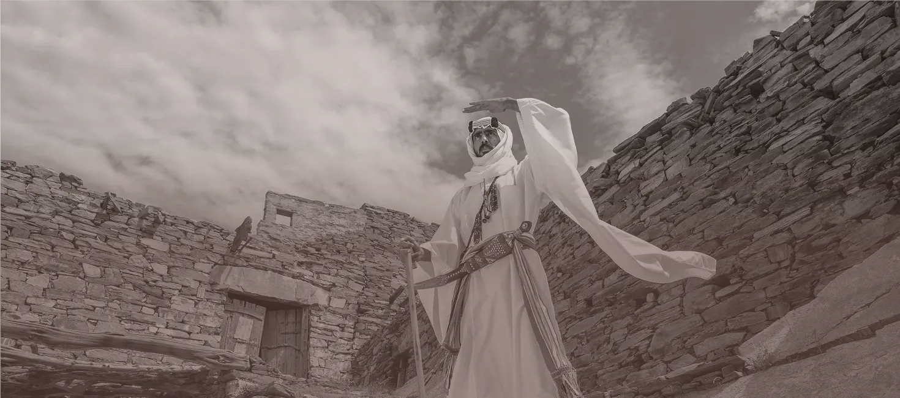

<section id="image-overview" class="nds-content-section nds-doc-overview">
  

    

      <h2 class="nds-section-title">Overview</h2>
    

    

An image is a box with one `img` inside. The box has a set shape, and the photo fills it: the parts that do not fit are cut off. A focal point picks the part of the photo that stays in view, and an overlay dims the photo with the overlay color. Every image in a row then has the same shape, whatever the size of each photo.

Pick another component when:

- the photo sits at the top of a card: the image header of a [Card](../components/card), with the same knobs
- the photo shows a person: [Avatar](../components/avatar)
- the photo is shown whole, at its own shape, in an article: a plain `img` in [Prose](../layout/prose)
- the photo fills the top of a page: [Hero](../ui-shell/hero)

  

</section>

<section id="image-markup" class="nds-content-section nds-doc-markup nds-demo-section">
  

    

      <h2 class="nds-section-title">Markup</h2>
    

    

    

  

</section>

<section id="image-variants" class="nds-content-section nds-doc-variants" hidden>
  

    

      <h2 class="nds-section-title">Variants</h2>
    

    

Shape, Focal point, Overlay and Corners set a custom property in the `style` attribute of `.nds-image`. Any other value works too: see API. A photo wider than its shape moves across with `--image-pos-x`; a taller one moves up and down with `--image-pos-y`.

| Group | Option | Markup | On element | Use |
|---|---|---|---|---|
| Structure | Photo (default) | — | — | One photo in a set shape |
| Structure | Viewer thumbnail | canon `#image-viewer` | — | A gallery tile of the [Image Popup Viewer](../components/ipv): a click opens the full photo. The outer `div` is one grid cell: the tile and its title. Keep `nds-ipv-thumbnail` on the `img` and `nds-image` on its card |
| Shape | 4:3 (default) | — | — | Gallery tiles and list thumbnails |
| Shape | 16:9 | `--image-ratio: 16 / 9` | `.nds-image` | Wide photos and video stills |
| Shape | 2:1 | `--image-ratio: 2 / 1` | `.nds-image` | Banners. The same shape as a card's image header |
| Shape | 1:1 | `--image-ratio: 1` | `.nds-image` | Square tiles |
| Shape | 3:4 | `--image-ratio: 3 / 4` | `.nds-image` | Upright photos, such as a building or a full-length portrait |
| Shape | 3:1 | `--image-ratio: 3 / 1` | `.nds-image` | A thin strip, such as a banner across a page section |
| Focal point | Center (default) | — | — | The middle of the photo stays in view |
| Focal point | Left | `--image-pos-x: 0%` | `.nds-image` | The left side stays in view, in both text directions. For a photo wider than its shape |
| Focal point | Right | `--image-pos-x: 100%` | `.nds-image` | The right side stays in view, in both text directions |
| Focal point | Top | `--image-pos-y: 0%` | `.nds-image` | The top stays in view: a face, a skyline. For a photo taller than its shape |
| Focal point | Bottom | `--image-pos-y: 100%` | `.nds-image` | The bottom stays in view |
| Overlay | None (default) | — | — | The photo as it is |
| Overlay | Light | `--image-overlay-opacity: 0.3` | `.nds-image` | A photo that steps back, such as a past event |
| Overlay | Strong | `--image-overlay-opacity: 0.6` | `.nds-image` | A photo kept only as a texture |
| Corners | MD (default) | — | — | 8px rounded corners, as a card's image |
| Corners | None | `--image-radius: 0` | `.nds-image` | Square corners, for a photo that meets the edge of its container |
| Corners | LG | `--image-radius: var(--radius-lg)` | `.nds-image` | 16px rounded corners, for a large photo |
{: #image-variants-table .nds-table .nds-responsive}

  

</section>

<section id="image-features" class="nds-content-section nds-doc-features">
  

    

      <h2 class="nds-section-title">Built-in Features</h2>
    

    

      

        

          
            <i class="hgi hgi-stroke hgi-image-crop"></i>
            Crop to Fill
          
          
The photo covers the whole box at any size, and the box keeps its shape. A row of photos of different sizes lines up.

        

        

          
            <i class="hgi hgi-stroke hgi-focus-point"></i>
            Focal Point
          
          
<code class="nds-inline-code lang-css">--image-pos-x</code> and <code class="nds-inline-code lang-css">--image-pos-y</code> pick the part of the photo that stays in view when the shape cuts it.

        

        

          
            <i class="hgi hgi-stroke hgi-layers-01"></i>
            Overlay With No Extra Layer
          
          
The overlay color is the background of the box, and the photo shows over it at a lower opacity. The box keeps its <code class="nds-inline-code lang-css">::before</code> and <code class="nds-inline-code lang-css">::after</code> free, so the viewer's zoom badge fits on the same box.

        

        

          
            <i class="hgi hgi-stroke hgi-album-02"></i>
            Shared With Card
          
          
A card's image header uses the same rules and the same knobs, with a 2:1 shape. A photo moves from a card to a gallery with no new values.

        

        

          
            <i class="hgi hgi-stroke hgi-user-circle"></i>
            Avatar Safe
          
          
An element that is also an <code class="nds-inline-code lang-html">nds-avatar</code> keeps the avatar's circle. The image rules skip it.

        

      

    

  

</section>

<section id="image-practices" class="nds-content-section nds-doc-practices">
  

    

      <h2 class="nds-section-title">Best Practices</h2>
    

    

- Put one `img` in the box. The rules style that image only.
- Put a row of images in a [Grid](../layout/grid). Each image fills the width of its column.
- Give every image in a row the same shape, so the row stays even.
- Write `alt` on the `img`. Write `alt=""` when the text next to the image says the same.
- Set the focal point when the subject is not in the middle. Without it, a shape can cut off a face at the top.
- Keep the overlay at 0.6 or less. A stronger overlay hides the photo.
- For a gallery the user opens full screen, use the Viewer thumbnail structure. Leave `nds-image` off when the gallery needs your own look: `nds-ipv-thumbnail` adds no style.
- Add `loading="lazy"` to an image far down the page.
- Set the knobs in the `style` attribute or in your CSS, not with a new class.

  

</section>

<section id="image-api" class="nds-content-section nds-doc-api">
  

    

      <h2 class="nds-section-title">API</h2>
    

    

### CSS Custom Properties
{: .nds-block-title}

Set these on `.nds-image`, or on a parent to change every image inside it. A card's `.nds-card-image` reads the same properties. A hero has its own overlay properties.

| Property | Default | Controls |
|---|---|---|
| `--image-ratio` | `4 / 3` | The shape of the box, as width / height. A card's image header defaults to `2 / 1` |
| `--image-pos-x` | `50%` | The part of the photo in view across. `0%` is the left edge in both text directions |
| `--image-pos-y` | `50%` | The part of the photo in view down. `0%` is the top edge |
| `--image-radius` | `var(--radius-md)` | The corner radius of the box |
| `--image-overlay-opacity` | `0` | How much the overlay covers the photo, from `0` to `1` |
| `--image-overlay-color` | `var(--background-image-overlay)` | The overlay color. The default is the theme's image overlay token, as on a hero |
{: .nds-table .nds-responsive}

  

</section>

<section id="image-related" class="nds-content-section nds-doc-related">
  

    

      <h2 class="nds-section-title">Related</h2>
    

    

- [News Article](../examples/news-article): a gallery of viewer thumbnails in an article.
- [Image Popup Viewer](../components/ipv): the full-screen viewer the thumbnails open.

  

</section>
